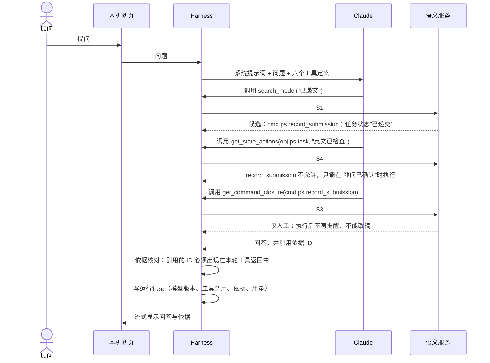
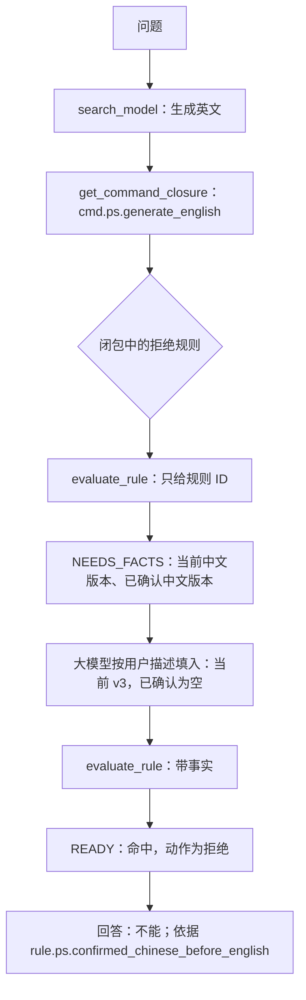

# 语义服务一期设计：从模型到知识包与接口返回

- 日期：2026-11-02
- 状态：设计草案，待用户评审；依附于 [ADR-001 至 ADR-004](../adr/README.md)（提议中）。
- 用途：说明在当前模型上怎样封装接口、返回什么、以什么形式交给问答 AI。任务拆分见[实施计划](../plans/model-qa-v1-tasks.md)。
- 示例来源：文中的返回示例由一次性原型脚本对当前模型（`0.1.0-draft`）实际计算得出，只做了截短，不是手写的样例。原型不进入仓库。

## 1. 先分清两种“知识包”

| 名称 | 是什么 | 何时产生 | 谁使用 |
|---|---|---|---|
| **模型知识包** | 整个模型的只读快照：全部元素、状态、规则条件、来源文档正文，带模型版本 | 构建时，由生成器从模型源生成，与 HTML 浏览页同源 | 语义服务启动时加载 |
| **语义上下文包** | 针对一次问题取出的那一小部分模型知识，加上判定结果和依据 | 运行时，每次接口调用返回 | 问答 AI（Harness）组织回答 |

参考材料中的“业务语义上下文包”对应后者。前者是投影文件，后者是接口返回。问答 AI 从不接触模型源或代码仓，只接触语义上下文包。

### 为什么不把整个模型直接给大模型

当前模型约 9.4 万字，放得进大模型的上下文；单个命令的闭包约 1.7 千字，小两个数量级。仍然按需取用，理由有三：

1. **规则要由服务判定，不由大模型推理**（标准原则“契约优于上下文”）。把规则原文交给大模型，等于让它自己判断规则是否命中。
2. **依据可核对。** 每次返回都列出依据 ID，回答引用的依据可以逐条核对是否真的来自模型。
3. **成本与干扰。** 每次提问都携带整个模型，费用高，无关内容也会干扰判断。模型继续增长后差距会更大。

## 2. 总体架构

```mermaid
flowchart LR
  subgraph 构建时
    M[模型源 model/] --> G[生成器 render_model.py]
    D[来源文档 docs/ 中被 refs 引用的部分] --> G
    G --> H[generated/ps-model-explorer.html<br/>模型浏览页]
    G --> K[generated/ps-model-knowledge.json<br/>模型知识包]
  end
  subgraph 运行时：语义服务 src/semantic
    K --> L[加载与版本锁定]
    L --> I[派生索引<br/>检索 / 规则按命令 / 命令按状态 / 关系邻接]
    I --> S1[search_model]
    I --> S2[get_element]
    I --> S3[get_command_closure]
    I --> S4[get_state_actions]
    I --> S5[evaluate_rule]
    I --> S6[get_sources]
  end
  subgraph 运行时：问答 AI src/qa
    W[本机网页] <--> R[Harness<br/>Tool Runner + 依据台账 + 运行记录]
    R <--> C[Claude API<br/>claude-opus-5-5]
    R --> S1 & S2 & S3 & S4 & S5 & S6
  end
```

- 生成器在一次运行里同时产出 HTML 浏览页和知识包，`--check` 同时检查两者与模型同步。
- 语义服务只读知识包，启动时记下模型版本，每次返回都带上这个版本（标准第 6.5 节）。
- Harness 只能调用 S1–S6。它没有文件、命令行或联网工具。

## 3. 模型知识包格式

文件：`generated/ps-model-knowledge.json`，禁止手改。

```json
{
  "format": "ps-model-knowledge/1",
  "model_version": "0.1.0-draft",
  "context": "ctx.ps.preparation",
  "stage_gates": {"stage_0": "passed", "stage_1": "passed", "stage_2": "passed", "stage_4": "not_started"},
  "source_digest": "模型源、Schema 与被引用文档的哈希",
  "generator_hash": "生成器与模板的哈希",
  "type_names": {"object": "业务对象", "command": "业务命令", "...": "取自 Schema 的 title"},
  "elements": ["与模型源逐字一致的全部元素，按源文件顺序"],
  "renderings": {"rule.ps.final_known_requirements": {"condition_text": "存在「稿件检查结果」（沿 任务包含检查结果）满足 (……)"}},
  "sources": {
    "docs/sources/model-review-2026-11-02.md": {
      "title": "模型源 v0.1 评审答复记录",
      "sections": [{"heading": "第四轮答复（Q-078、Q-079 及提案合入）", "level": 2, "text": "……"}]
    }
  }
}
```

设计取舍：

- **规则条件的中文写法由生成器统一渲染一次**，写入 `renderings`，HTML 页面与知识包共用。现在这段逻辑只写在 HTML 模板的 JavaScript 里，若语义服务再用 Python 实现一份，两边迟早不一致。这是知识包里唯一的派生内容。
- **元素原样保存，不预先计算索引。** 知识包是模型的忠实投影，便于核对与回放。索引在语义服务加载时派生，一百多个元素毫秒级完成；如果把索引放进文件，就会多出一份可能与元素不一致的数据。
- **来源文档按标题切成段落。** S6 按段落返回，不返回整篇文档。只收录模型 `refs` 引用到的 `docs/` 文档；现有引用同步工具已限制引用只能指向 `docs/*.md`。
- **类型中文名取自 Schema 的 `title`**，与 HTML 页面一致，不另建字典（AGENTS.md 约定）。

## 4. 接口统一返回结构

六个接口的返回都套在同一个结构里。这一层就是“语义上下文包”：

```json
{
  "status": "READY",
  "model_version": "0.1.0-draft",
  "result": {},
  "missing_facts": [],
  "applicable_rules": [],
  "evidence": [{"id": "cmd.ps.record_submission", "basis": "confirmed_business", "sources": ["docs/..."]}],
  "constraints": [],
  "next_actions": []
}
```

| 字段 | 含义 | 规则 |
|---|---|---|
| `status` | `READY` 可用；`NOT_FOUND` 模型中没有；`NEEDS_FACTS` 判定缺事实；`INVALID_INPUT` 参数不合法 | 不再使用 ADR-002 草案中的 `AMBIGUOUS`、`OUT_OF_SCOPE`：检索返回带分数的候选，由大模型选择；是否超出范围，由大模型依据上下文元素 `ctx.ps.preparation` 的范围说明判断 |
| `result` | 结构化结果，见第 5 节各接口 | 只放模型里有的内容，不生成自然语言结论 |
| `missing_facts` | 判定还缺哪些事实，每项给出对象、属性及其业务含义 | 仅 S5 使用 |
| `applicable_rules` | 本次命中的规则 ID | 仅 S5 使用 |
| `evidence` | 本次返回所依据的元素 ID、依据状态（已确认业务 / Agent 提案）、来源文档 | 每个接口都必须填写；问答 AI 的回答只能引用这里出现过的 ID |
| `constraints` | 与本次结果相关的执行约束，如执行等级、只能人工执行 | 供回答“能不能做、谁来做” |
| `next_actions` | 建议的下一步查询，例如“可再取某命令闭包” | 只是建议，不是执行授权 |

## 5. 六个接口

每个接口说明三件事：输入、怎样从模型计算、返回什么。这些接口会注册为大模型的工具，名称用英文，描述用中文。

### S1 `search_model`：把用户的说法对应到模型元素

- **输入**：`query`（1 到 50 字）；`types`（可选，限定元素类型）；`limit`（默认 8）。
- **计算**：
  - 对每个元素的中文名、ID、状态中文名、属性含义建立检索文本。
  - 打分：名称包含整个查询词计 1 分；另加汉字二元组重合率（中文不分词也能部分匹配）；属性含义的匹配权重减半。
  - 状态单独作为结果项返回，例如“项目 PS 准备任务 · 已递交”。
- **返回**：候选列表，每项含 ID、类型、名称、命中字段、分数；无候选时为 `NOT_FOUND`。
- **原型实测**：查“已递交”命中“记录已递交”命令，以及任务的“已递交”状态。
- **已知局限**：同义词靠二元组重合，例如“交了”“提交”可能找不到“已递交”。先用评测集检验召回率，不足时再在元模型中为元素增加别名字段（需评审）。

### S2 `get_element`：读取一个元素的完整定义

- **输入**：`id`。
- **计算**：返回该元素原文，再按类型补充便于阅读的内容：
  - 对象：属性（名称、类型、含义、可否为空、枚举值），状态及中文名。
  - 规则：约束强度、动作、作用的命令（附中文名）、对象绑定、条件的中文写法（取自知识包的 `renderings`），以及事实模板（见 S5）。
  - 策略：触发事件或定时、目标命令、目标实例范围、时限。
  - 人工决策点：所在位置和判断指引。
  - 所有元素：进出的关系（只列 ID 与名称）。
- **返回**：`result.element`；`evidence` 为该元素本身。不存在时为 `NOT_FOUND`。

### S3 `get_command_closure`：一个命令的完整约束（标准第 6.4 节）

- **输入**：`command_id`。
- **计算**：
  - 所属聚合与不变量。每条不变量注明它实际作用于哪些命令，避免大模型误以为不变量约束当前命令。
  - 前置状态与转换。`same` 显示为“留在当前状态”，`previous` 显示为“回到放弃前状态”。
  - 作用于该命令的全部规则：强度、动作、依据状态。
  - 人工决策点：直接设在该命令上的，以及设在这些规则上的。
  - 触发该命令的策略，以及该命令产生的事件会触发的下游策略。
  - 执行角色、执行等级、参数、业务后果（`effects`）。
- **原型实测**（记录已递交，截短）：

```json
{
  "status": "READY",
  "model_version": "0.1.0-draft",
  "result": {
    "command": {"id": "cmd.ps.record_submission", "name": "记录已递交", "role": "顾问", "execution_level": "仅人工",
                "effects": ["顾问手动递交后记录；此后不再提醒资料变化，也不再修改该项目稿件；系统不操作网申"]},
    "preconditions": {"allowed_in": ["顾问已确认"], "transition_to": "已递交"},
    "rules": [], "human_decision_points": [], "triggered_by_policies": [], "downstream_policies": []
  },
  "evidence": [{"id": "cmd.ps.record_submission", "basis": "confirmed_business",
                "sources": ["docs/sources/model-review-2026-11-02.md", "docs/proposals/ps-model-change-2026-11-02.md"]}]
}
```

  “检查英文稿及依据”的闭包含 5 条规则、2 个人工决策点，约 1.7 千字。

### S4 `get_state_actions`：某个状态下能做什么、不能做什么

- **输入**：`object_id`；`state`（状态值或中文名均可）。
- **计算**：遍历以该对象为根的命令。前置状态包含当前状态的列为“允许”，并附执行角色、执行等级、目标状态、会拦截或转人工的规则；其余列为“不允许”，并附它们允许的状态。
- **原型实测**（任务处于“英文已检查”，截短）：

```json
{
  "result": {
    "state": {"value": "checked", "name": "英文已检查"},
    "allowed": [
      {"id": "cmd.ps.confirm_final", "name": "顾问最终确认", "role": "顾问", "execution_level": "仅人工", "to": "顾问已确认",
       "checks": ["deny:rule.ps.english_matches_chinese", "deny:rule.ps.current_version_checked",
                  "deny:rule.ps.confirm_current_english", "deny:rule.ps.final_known_requirements"]},
      {"id": "cmd.ps.revise_english_wording", "name": "修订英文措辞", "to": "英文已生成"},
      {"id": "cmd.ps.record_withdrawal", "name": "记录客户放弃申请", "to": "客户已放弃"}
    ],
    "not_allowed": [
      {"id": "cmd.ps.record_submission", "name": "记录已递交", "allowed_in": ["顾问已确认"]},
      {"id": "cmd.ps.generate_english", "name": "依据确认中文生成英文", "allowed_in": ["中文已确认"]}
    ]
  }
}
```

  “现在能直接记录已递交吗”可以据此回答：不能，要先最终确认，然后由顾问记录。

### S5 `evaluate_rule`：按用户描述的假设情景判定规则

分两步，避免大模型猜测需要哪些事实：

1. **只给规则 ID**：返回 `NEEDS_FACTS` 和事实模板。模板从规则条件中引用的对象和属性推出，标明哪些对象是列表（量词绑定），每个属性附业务含义与枚举值。
2. **带上事实**：先校验属性名与枚举值，不合法返回 `INVALID_INPUT`；事实不全返回 `NEEDS_FACTS` 并列出仍缺的部分；事实齐全时，用现有校验器的三值判定逻辑计算，返回是否命中、命中后的动作。结果标明 `hypothetical: true`。

- **原型实测**，第一步（“当前中文须经学生确认再生成英文”）：

```json
{
  "status": "NEEDS_FACTS",
  "missing_facts": [{"concept": "obj.ps.task", "name": "项目 PS 准备任务", "is_list": false,
    "attributes": [{"name": "chinese_confirmed_version", "meaning": "学生已确认的中文版本"},
                   {"name": "current_chinese_version", "meaning": "当前中文版本"}]}]
}
```

- **原型实测**，第二步（当前中文 v3，尚无已确认版本）：

```json
{"status": "READY",
 "result": {"rule": {"id": "rule.ps.confirmed_chinese_before_english"}, "matched": true, "action": "deny", "hypothetical": true},
 "applicable_rules": ["rule.ps.confirmed_chinese_before_english"]}
```

- 判定逻辑直接复用 `tools/checks/validate_model.py` 的 `evaluate`，与模型测试中的假设场景得到相同结果。

### S6 `get_sources`：查原始业务依据

- **输入**：`element_id`；`max_sections`（默认 3）。
- **计算**：在该元素 `refs` 指向的文档中，优先选出包含该元素 ID 的段落，其次是包含其中文名关键词的段落。
- **返回**：文档路径、标题、段落标题与正文，统一标注为“参考知识”。
- **已知局限**：段落挑选靠关键词，可能漏掉相关段落；每次都返回文档列表，用户可自行打开原文。

## 6. 一次问答的调用流程

问题：“任务现在是英文已检查，可以直接记录已递交吗？”



Harness 的两个关键职责：

1. **依据台账**：每轮问答中，所有工具返回的 `evidence` ID 汇总成台账。回答中引用的 ID 必须在台账里；不在台账里的，网页上标为“依据未经核实”，评测中计为依据错误。这样“回答只能以模型为准”就不只是提示词要求，而是可以检查的约束。
2. **系统提示词只写行为约束**：回答格式、以模型为准、不编造、规范性规则结论不改写、超出范围如实说明。业务规则一律经工具取得，系统提示词里不写任何业务规则。

## 7. 规则判定的调用流程

问题：“学生还没确认中文稿，能先生成英文吗？”



用户描述不足以填事实时，大模型应该反问用户，或者说明在哪些条件下会被拦，而不是自己假设事实。

## 8. 与参考材料九项服务的对应

| 参考材料 | 一期 | 说明 |
|---|---|---|
| C01 search_semantics | S1 | — |
| C02 get_semantic_context | S2、S3 | 按命令取闭包 |
| C03 resolve_business_context | S1 部分 | 一期只做术语对应；二期有业务数据后再做实例解析 |
| C04 resolve_business_solution | S4 | 一期只回答“某状态下能做什么” |
| C05 evaluate_business_rule | S5 | 一期只判定假设情景 |
| C06 query_business_data | 二期 | 需业务系统 |
| C07 preflight_action / C08 execute_business_action | 三期 | 需控制层 |
| C09 get_business_evidence | S6 部分，加上每次返回的 `evidence` | 一期没有运行证据 |

## 9. 怎样验证这一层（不调用大模型、不花钱）

语义服务是确定性代码，可以离线验证：

1. **与模型一致**：S3 的规则清单与校验器的规则绑定一致；S4 的允许 / 不允许与对象状态转换一致；S5 对 `tests/model/scenarios.yaml` 中全部假设场景给出相同结论。
2. **依据可达**：评测集 33 题中每个 `evidence` ID，用它的中文名调用 S1 都能排进前 8 名，并且 S2 能读出。这项检查在接入大模型之前，就能说明需要的依据取得到。
3. **返回结构**：每个接口的返回都符合统一结构，`evidence` 非空，`model_version` 与知识包一致。

接入大模型之后，正确率与越界次数由评测集衡量（阶段 5 阈值：正确率不低于 90%，越界 0 次）。
