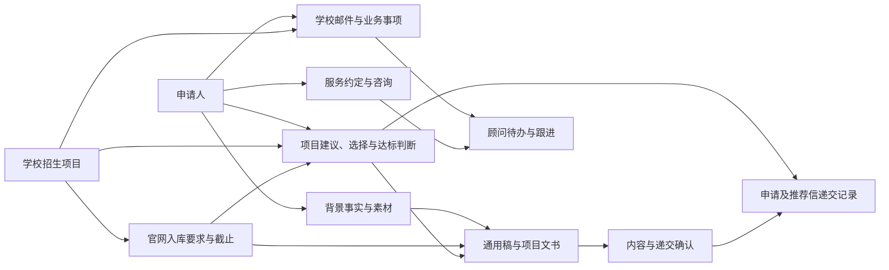

# 业务概念与关系整理

- 依据：[业务流程](service-workflow.md)、[自主工作目标](agent-autonomy-requirements.md)、[客户知识与 PS 范围](customer-knowledge-and-task-scope.md)及其用户陈述来源。
- 当前层次：整理已确认业务含义和关系，供后续正式建模使用；不是聚合根划分、数据库表结构或任务执行设计。
- 工作名称可在后续统一，不因此改变已确认事实。
- 当前结构化定义入口为[模型源草案](../../model/README.md)。本文件保留发现阶段的概念解释，后续业务定义变更经模型源和评审提案处理；不在概念说明或未来 HTML 中另建一套权威模型。

## 1. 客户与服务

- 申请人关联自己的基础背景、经历事实、素材、参考稿和中文确认内容；已确认事实在本人相关任务中复用。
- 学生和家长均参与销售与服务沟通，顾问不调解家庭分歧；签约、付款等具体角色按相应服务约定记录，不从家长身份推断。
- 服务约定描述实际合同版本、交付范围、双方配合、费用与阶段期限；申请事务与保留的 12 个月求职服务分别描述。
- 咨询围绕学生兴趣、优势、短期长期规划和准备建议持续进行，结合答疑与关键节点主动跟进。

## 2. 项目资料与规则知识

- 学校关联具体招生项目，项目资料包含名称、方向课程、语言、学制费用、截止等已确认信息需求。
- 项目要求适用于相应项目、申请季及其他需要区分的范围，包含最低申请标准和材料写作要求。
- 官方条件来自学校官网，结构化维护入库；AI 先查库、缺失查官网、入库后使用。
- 申请系统差异由顾问手动操作发现并反馈，按模型修订或补充相应内容。
- 历史录取背景与顾问经验作为参考，不能替代官网最低条件，也不因无同类案例就阻止申请。

## 3. 学生与项目之间的业务关系

- 项目建议将某位学生与某个项目联系起来，分别说明申请机会和方向适合理由。
- 客户反馈是是否选择项目，不增加认可 AI 分析的业务环节。
- 选择意向用于安排准备；正式递交前仍明确确认项目和最终材料。
- 达标判断关联学生当前资料与官网入库条件，与录取机会分析及客户是否选择项目分别理解。
- 已达标项目优先准备 PS，组内按截止排序。未达标时可能沟通放弃，不自动修改客户选择。
- 未达标但仍希望申请由顾问与客户人工决定，未达标原因和最终选择分别记录，继续申请不改写资格事实（用户已确认）。

## 4. 文书与确认

- 学生背景事实共用；PS 通用初稿关联某位学生的具体申请方向，不同方向分别准备，用于后续按项目加工。
- 方向初稿是可复用资料；用户允许缺少时直接依据学生事实和项目要求准备项目稿，后续仍按中文核对、英文生成、最终确认处理。
- PS 项目最终稿关联明确指定的项目；指定多个项目时分别编写。每个已选项目准备 PS 是当前服务准备要求。
- CV、PS、推荐信草稿与面试问答引用相关经历事实、素材与项目要求。
- 学生核对中文稿；中文确认后 AI 生成英文；经历变化先改中文再重新生成英文；AI 辅助检查、顾问最后确认。
- 确认记录关联实际被确认的内容和版本，事实复用不等于其他稿件或递交已被批准。

## 5. 递交、通知与跟进

- 对具体学生和项目记录主申请递交，与推荐人自行上传、顾问手动递交推荐信的状态分别理解。
- 每位学生有顾问维护的申请专用邮箱，关联各学校网申账号。
- 学校邮件关联申请业务事项，形成事件分类；存在行动要求时提取顾问待办，一封邮件多个要求分别提取。
- 一般学校询问和既有事实说明由顾问处理，涉及客户意愿或承诺时先取得客户决定。
- 任务、材料及文书受背景或项目要求变化的影响范围按已确认关系评估，执行机制后置。

## 6. 核心业务关系图

箭头表示业务关联，不表示固定时间顺序或聚合边界。

## 7. 从关系支持 AI 自主工作

以项目最终 PS 为例，AI 从明确的学生和项目取得背景与材料、官网入库要求、客户选择、达标判断和截止，按优先级准备，再关联中文核对、英文生成、检查与最终确认。顾问不需每次手动列出整套依赖。

通用初稿与项目最终稿需要的信息范围不同，模型需保留这种区别。资料未知、矛盾和变化影响均按既有业务原则处理，不由本图新增操作权限。

## 8. 仍待决定

- 首场景及文书准备边界已确认；指标和验收表达仍待对齐。当前先整体审阅业务含义并验证模型表达，真实案例后置，见[阶段收口记录](../scenarios/first-scenario/questions.md)和[模型验证问题草案](ps-task-context.md)。跨客户复用、话术适配、跟进节奏及求职服务边界已在 R24 确认。
- 某些合同外情形、具体要求的适用范围及其他细节随后续业务继续梳理；本文件不将未决内容视为已完成。
