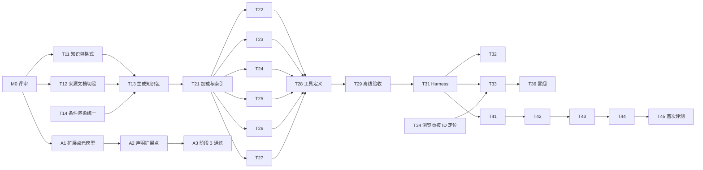

# 问答 AI 一期实施计划

- 日期：2026-11-02
- 状态：待用户评审。评审通过、且 [ADR-001 至 ADR-004](../adr/README.md) 采纳后再开始实施。
- 设计依据：[语义服务一期设计](../design/semantic-service-v1.md)。
- 原则：
  - 每个任务都有可检查的完成标准。
  - 先完成不调用大模型、不产生费用的部分（里程碑 M1、M2），再接入大模型。
  - 每次产生 API 费用前先估算，并经用户同意。

## 里程碑

| 里程碑 | 内容 | 是否产生 API 费用 | 完成后能看到什么 |
|---|---|---|---|
| M0 | 评审设计与架构决策 | 否 | ADR 状态改为已采纳 |
| M1 | 模型知识包 | 否 | `generated/ps-model-knowledge.json` 随模型同步生成 |
| M2 | 语义服务（离线） | 否 | 六个接口可在命令行调用；依据可达性报告 |
| M3 | 网页问答 AI | 少量（冒烟测试） | 本机网页可以提问，回答附依据 |
| M4 | 首次评测 | 是 | 问答正确率基线与越界次数 |

另有一条独立的阶段 3 收口线（A 线），与 M1 到 M4 并行，不影响问答 AI。

## M0 评审

| 编号 | 任务 | 产出 | 完成标准 |
|---|---|---|---|
| T00 | 用户评审 ADR-001 至 ADR-004、设计文档与本计划 | Q-081 结论 | ADR 状态改为“已采纳”，或按意见修改后再评审 |

## M1 模型知识包（无费用）

| 编号 | 任务 | 产出 | 完成标准 | 依赖 |
|---|---|---|---|---|
| T11 | 定义知识包格式 | `tools/generator/knowledge.schema.json` | 覆盖设计文档第 3 节全部字段；生成的知识包能通过该 Schema 校验 | T00 |
| T12 | 来源文档按标题切段 | 生成器中的切段函数 | 段落保留标题层级；去掉自动生成的模型关联索引块；只收录模型 `refs` 引用的 `docs/` 文档；有单元测试 | T00 |
| T13 | 生成器输出知识包 | `generated/ps-model-knowledge.json` | 与 HTML 同一次生成；`--check` 能发现知识包过期或被手改；元素与模型源逐字一致；版本与 `model.yaml` 一致；相同输入生成结果逐字节相同 | T11、T12、T14 |
| T14 | 规则条件中文渲染统一到生成器 | 生成器中的 Python 渲染函数；HTML 模板改用渲染结果 | HTML 页面显示的条件文字与改动前一致；知识包 `renderings` 覆盖全部规则；JavaScript 中不再保留渲染逻辑 | T00 |
| T15 | 更新文档 | 生成器 README、模型 README | 写明知识包用途、禁止手改、检查命令 | T13 |

## M2 语义服务（离线，无费用）

位置：`src/semantic/`；测试：`tests/semantic/`。

| 编号 | 任务 | 产出 | 完成标准 | 依赖 |
|---|---|---|---|---|
| T21 | 加载、版本锁定、派生索引、统一返回结构 | 加载模块；返回结构与状态码 | 加载时校验知识包格式；派生索引包括：规则按命令、人工决策点按位置、策略按命令与事件、命令按对象与状态、关系邻接、检索文本；每个返回都带模型版本 | T13 |
| T22 | S2 `get_element` | 接口实现 | 按类型补充可读内容（设计第 5 节）；不存在返回 `NOT_FOUND`；全部元素都能读出且 `evidence` 非空 | T21 |
| T23 | S3 `get_command_closure` | 接口实现 | 规则清单与校验器的规则绑定一致；不变量注明实际作用的命令；`same` / `previous` 显示为中文说明；全部 22 个命令都有测试 | T21 |
| T24 | S4 `get_state_actions` | 接口实现 | 状态值或中文名均可输入；每个状态的“允许”集合与对象状态转换完全一致；任务全部 9 个状态都有测试 | T21 |
| T25 | S5 `evaluate_rule` | 接口实现 | 事实模板能从规则条件推出（含列表型对象）；非法属性或枚举值返回 `INVALID_INPUT`；事实不全返回 `NEEDS_FACTS` 并列出缺口；`tests/model/scenarios.yaml` 的全部场景经接口判定结果与模型测试一致 | T21 |
| T26 | S1 `search_model` | 接口实现与依据可达性报告 | 状态中文名可检索；评测集 33 题的每个依据 ID，用其中文名检索都在前 8 名；报告列出未达到的项 | T21 |
| T27 | S6 `get_sources` | 接口实现 | 只返回元素 `refs` 指向的文档段落；包含元素 ID 的段落排在最前；结果标注为参考知识 | T21 |
| T28 | 六个工具的定义 | 名称、中文描述、输入 JSON Schema（严格模式） | Schema 合法且禁止额外字段；描述中写明何时使用；测试固定工具清单，防止无意变更 | T22–T27 |
| T29 | 离线验收 | 测试结果与可达性报告 | `tests/semantic` 全部通过；模型、生成器测试仍全部通过；可达性未达项逐条说明原因（模型缺口或检索不足） | T28 |

M2 完成后先停下，把可达性报告给用户看，再进入 M3。

## M3 网页问答 AI（少量费用）

位置：`src/qa/`。

| 编号 | 任务 | 产出 | 完成标准 | 依赖 |
|---|---|---|---|---|
| T31 | Harness | Tool Runner 调用；系统提示词；模型参数 | 只注册六个工具；`claude-opus-5-5`，自适应思考，`effort` 显式为 `medium`，流式，服务端回退；系统提示词不含任何业务规则（有测试检查不出现规则 ID 与规则原文） | T29 |
| T32 | 依据台账与运行记录 | 台账核对；本机运行记录 | 回答中引用的 ID 若不在本轮工具返回中，标为“依据未经核实”；每条记录含模型版本、工具调用、依据、用量；记录目录不纳入 Git | T31 |
| T33 | 本机网页 | 后端加单页聊天界面 | 只监听 `127.0.0.1`；流式显示；依据可点开（调用 S2）；显示模型版本；一条命令启动 | T31、T34 |
| T34 | 模型浏览页支持按元素 ID 定位 | 模板改动 | 打开 `ps-model-explorer.html#<元素 ID>` 直接选中该元素；生成器测试覆盖 | T00 |
| T35 | 依赖与启动说明 | 固定版本的依赖清单；README | 新环境按说明可启动；Anthropic SDK 版本固定 | T33 |
| T36 | 冒烟测试 | 3 到 5 个问题的问答记录 | 先估算费用并经用户同意；回答带依据且台账核对通过 | T33 |

## M4 首次评测（产生费用）

位置：`evals/model-qa/`。

| 编号 | 任务 | 产出 | 完成标准 | 依赖 |
|---|---|---|---|---|
| T41 | 评测程序 | 逐题运行脚本 | 使用与网页相同的 Harness；保存每题回答、工具调用、依据台账 | T31 |
| T42 | 自动初判 | 初判结果 | 依据项由台账自动判定；要点与禁止项由大模型按题目字段打分，输出结构化结果 | T41 |
| T43 | 人工确认 | 网页中的逐题确认页 | 显示问题、回答、初判；顾问可确认或改判，改判必须填理由（标准第 6.3 节） | T42、T33 |
| T44 | 指标汇总 | `evals/model-qa/reports/` 下的报告 | 输出问答正确率、越界次数、分类别结果，并与阈值比较；报告注明模型版本 | T43 |
| T45 | 首次正式评测 | 问答正确率基线 | 先估算费用并经用户同意；结果写入画布与 Q-071；未达阈值时逐题归因为模型缺口、语义服务缺陷或回答约束问题，模型缺口写成模型变更提案 | T44 |
| T46 | 用户补题（可选） | 新增题目与重算的基线 | 用户补约 10 题后重算静态可支撑率与问答正确率 | T45 |

## A 线：阶段 3 收口（与上面并行）

| 编号 | 任务 | 产出 | 完成标准 | 依赖 |
|---|---|---|---|---|
| A1 | 扩展点元模型结构化 | Schema、校验器、测试 | 扩展点有名称、命令、用途、类别；校验器检查命令属于该聚合；有拒绝用例测试 | T00 |
| A2 | 在模型中声明 ADR-004 的 7 个扩展点 | 模型源、HTML | 模型校验通过；浏览页可看到扩展点 | A1 |
| A3 | 阶段 3 通过 | 画布与 `model.yaml` 更新 | 三项通过条件均满足，并经用户确认 | A2 |

## 需要用户决定的节点

1. **T00**：采纳架构决策、设计与本计划。
2. **T29 之后**：看依据可达性报告，决定是否进入 M3。
3. **T36、T45**：确认 API 费用估算。
4. **A3**：确认阶段 3 通过。
